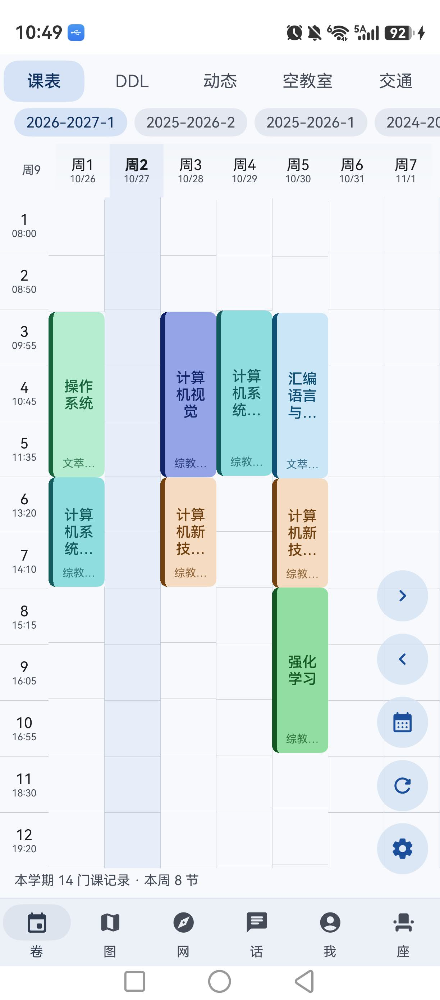
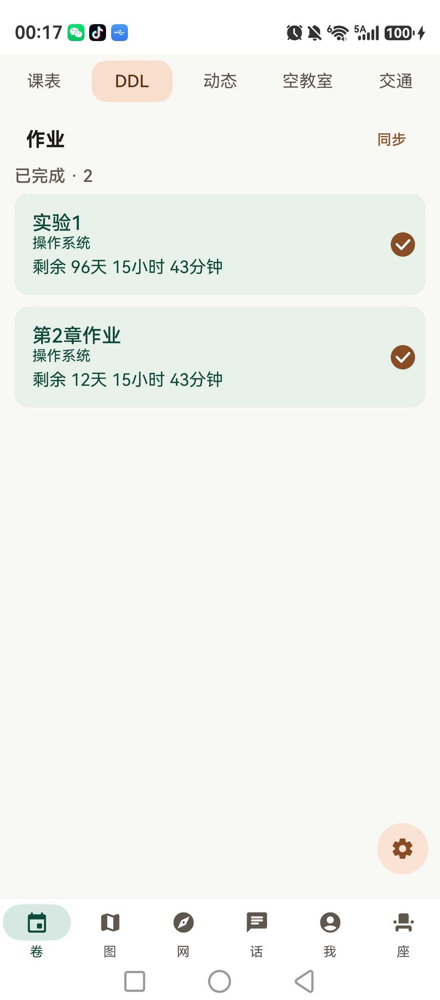
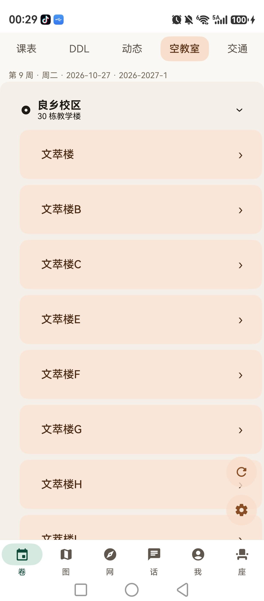
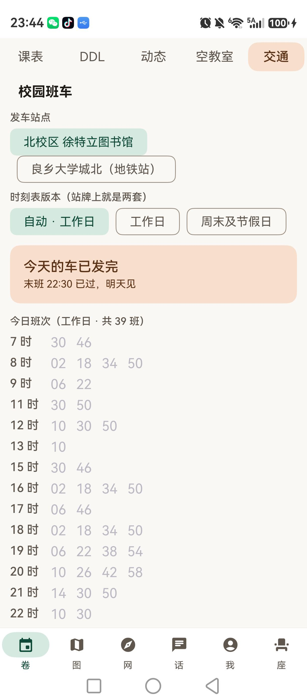
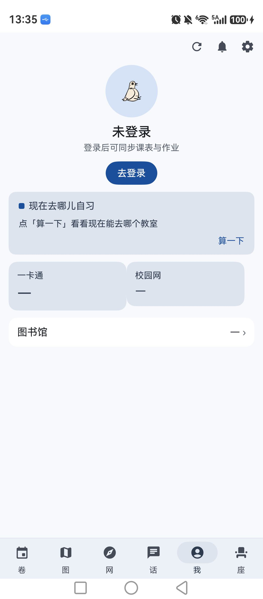
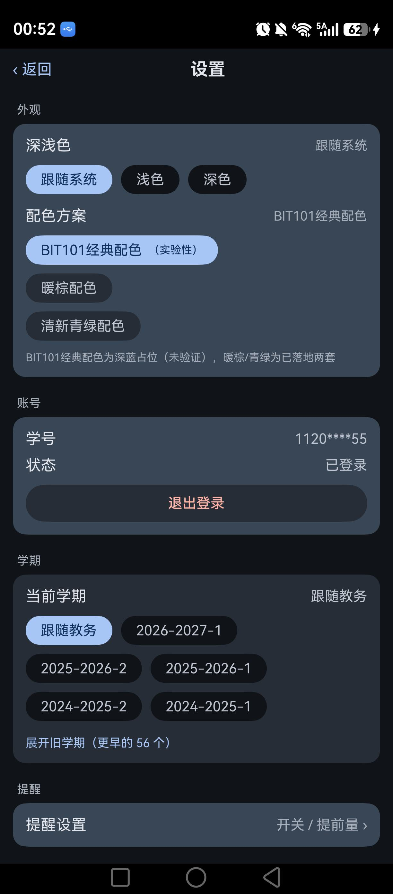
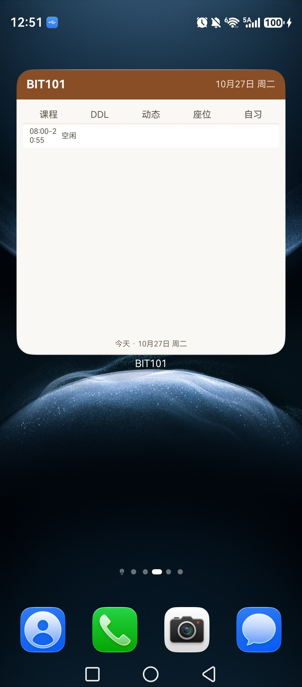
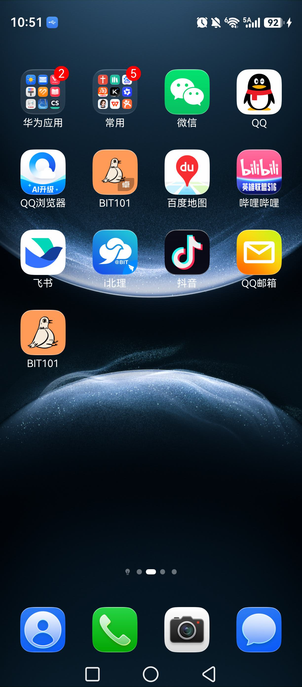

# BIT101 Harmony

> 北京理工大学（BIT）校园助手的 **HarmonyOS NEXT** 原生客户端 —— 课表、空教室、自习去处、班车、作业 DDL、座位预约。

[](https://github.com/Star2121-1/BIT101-Harmony/actions/workflows/test.yml)
[](LICENSE)


> ⚠️ **非官方客户端**：与北京理工大学及任何校内机构无关，纯个人项目，仅供学习交流。
> 所有接口都来自学校对外提供、浏览器本来就能访问的服务，随时可能变更。
> 请勿用于任何违规用途（抢座脚本、批量请求、绕过限制等）。
> 未在应用市场上架，目前是 `1.0.0-alpha.9`。

---

## 截图

> 全部为荣耀/华为鸿蒙真机截图（nova 14 Pro，1224×2776）。截图时间 2026-10-26 ~ 10-28，
> 此后仍有微调（例如课表页的学期 chips 行已迁到「设置 → 学期」）。

<table>
  <tr>
    <td align="center"><br><sub>课表（13 节 × 7 天 / 12 色 / 教学调整）</sub></td>
    <td align="center"><br><sub>作业 DDL（紧急度混色 / 勾选持久化）</sub></td>
    <td align="center"><br><sub>空教室（校区 → 楼 → 教室）</sub></td>
    <td align="center"><br><sub>班车（两站 / 末班判定）</sub></td>
  </tr>
  <tr>
    <td align="center"><br><sub>「我」（账号 + 自习卡 + 三卡摘要）</sub></td>
    <td align="center"><br><sub>设置 · 学期（近 3 学年 + 折叠旧学期）</sub></td>
    <td align="center"><br><sub>桌面 4×4 卡片（Form Kit）</sub></td>
    <td align="center"><br><sub>桌面图标（鸽子占画布 62%）</sub></td>
  </tr>
</table>

---

## 为什么单独做一版

Android 版是用 WebView 承载学校 CAS 登录页的，在 HarmonyOS 上这条路走不通：登录页的 Angular 应用能加载、脚本也跑了，但**表单输入框永远不渲染**（实测 `inputs=0`），页面上只剩第三方登录（微信 / SAML / Office365）。

所以这版改成**纯 HTTP 协议登录**，完全不依赖 WebView：

```
取登录页 → 解析六锚点 → AES 加密口令 → USTS 风控指纹
  → POST 得 302 + ticket → phpCAS → seatlib JWT → 业务接口
```

链路已在真机逐环节验证，含对照组：不给 token 时业务接口返回 `code=10001`，给真 token 返回 `code=1`。

---

## 功能

图例：✅ 已完成并真机验证 · 🔄 代码与单测完成，部分验证依赖有效校方会话 · ⬜ 未做

### 课表

| 功能 | 状态 | 说明 |
|---|---|---|
| 学号密码登录 | ✅ | 纯 HTTP，密码不落盘、不进日志 |
| 登录态持久化 | ✅ | 落盘 cookie + JWT，冷启动静默恢复 |
| 课表网格 | ✅ | 13 节 × 7 天，课程 12 色，跨节次合并 |
| 周次 / 学期切换 | ✅ | 学期列表一次拉回 61 个；学期切换在「设置 → 学期」，默认只显示近 3 学年、更早的折叠 |
| 教学调整识别 | ✅ | 自动识别「10/10 按周四课表上课」这类通知，列头标「放假 / 补课」 |
| 离线可读 | ✅ | 有缓存先上屏；刷新失败如实标注「显示的是缓存」，不清屏 |
| 考试安排 | ✅ | 日期 / 时间 / 地点 / 座位号，按日期升序 |
| 手动改课表（覆盖层） | 🔄 | 改教室 / 时间 / 周次、隐藏已退的课、加旁听课；重新同步不冲掉修改 |

### 教室与自习

| 功能 | 状态 | 说明 |
|---|---|---|
| 空教室查询 | ✅ | 校区 → 教学楼 → 教室三级折叠，逐间显示忙闲节次 |
| 「现在去哪儿自习」 | ✅ | 有课就说明正在上什么；空闲给 8 个候选，可换一批 |
| 自习降级态 | ✅ | 断网时课表照给 + 说明「查不了空教室」+ 标注学期未确认 |

### 作业与动态

| 功能 | 状态 | 说明 |
|---|---|---|
| 延河课堂作业（DDL） | ✅ | App 内 Web 登录抽 cookie → 同步截止时间；未完成 / 已完成分区，勾选杀进程不丢 |
| 本地新增作业 | ✅ | 右下「＋」新增（标题 / 说明 / 截止日期时间），本机条目单独标记、可删 |
| 课程动态 | ✅ | 各课程最新活动流；点条目在 App 内 Web 壳带会话打开 |

### 校园生活

| 功能 | 状态 | 说明 |
|---|---|---|
| 班车时刻 | ✅ | 两站 39 / 50 班，末班判定「今天已发完」 |
| 座位预约 | 🔄 | 校区 / 楼层 / 区域三级 + 底图选座 + 我的预约 + 违约计数；**提交需有效 seatlib 会话，真机未全验** |
| 一卡通余额 | 🔄 | 余额 + 近 N 天趋势；「请求失败 ≠ 未登录」三态分离 |
| 校园网流量 | 🔄 | 本月流量 / 今日用量 / 月末预测；三态分离（在线 / 未认证 / 不在校园网） |
| 图书馆借阅 | 🔄 | 在借 + 应还倒数 + 历史 |

### 个性化与系统集成

| 功能 | 状态 | 说明 |
|---|---|---|
| 配色方案 | ✅ | 三套皮肤（BIT101 经典 / 暖棕 / 清新青绿），全部由 token 层 `gridTokens()` 统一供色 |
| 深色模式 | ✅ | 跟随系统 / 浅色 / 深色，WCAG 对比度由单测钉住 |
| 作息自定义 | ✅ | 13 节可改，重叠 / 越界会被拦下并说明原因 |
| 提醒 | ✅ | 上课 / 作业 / 座位 / 考试 / 补课，各自开关与提前量；通知历史可查 |
| 桌面卡片 | ✅ | Form Kit 4×4：课程 / DDL / 动态 / 座位 / 自习 5 页签，随 App 配色与深色模式走 |

**未做**：成绩查询（逻辑层与 82 条单测已就绪，页面未做）、卡片点击深链、卡片定时刷新、校园地图、版本更新引导。

**明确不做**：NFC 校园卡（设备与协议都不支持）、社区论坛（话廊）、后台自动抢座。

---

## 与原版 Android 版的差距

对照基准：`harmony/ui-ref/MIGRATION-BASELINE.md`（**仓库外**，平板原版截图逐像素采样 + 源码常量双证）。
色值/尺寸/结构的完整对照记录见 [`docs/README.md`](docs/README.md)。

### 已经对齐的

| 项 | 说明 |
|---|---|
| 框架 chrome | 底部 6 模块（卷 / 图 / 网 / 话 / 我 / 座）+ 顶部 5 页签（课表 / DDL / 动态 / 空教室 / 交通），Stack 保活 |
| 课表页 | 网格、12 色块 + 左侧 ink 竖条、今日列 tint、教学调整列头、FAB 规格 42vp / primaryContainer×0.8 |
| 空教室页 | 校区卡 → 教学楼卡 → 教室卡的 25vp 逐级缩进、双色教室项、右下「回到顶部 + ⚙」 |
| 作业页 | 分区标题 + 紧急度混色卡 + 右侧勾选框 + 三颗 FAB（＋ / 学士帽 / ⚙） |
| 班车页 | M3 FilterChip 语义（选中薄荷底 + 深绿字）、下一班 primaryContainer 卡 |
| 「我」页 | 入口组整组删除（原版没有）、账号区居中铺背景 + 品牌头像 |
| 图标 | 桌面图标鸽子占画布 62%（`tools/make-icon.py --percent N` 可复现） |

### 明确还没对齐的（如实记录）

| 差距 | 现状 | 原因 |
|---|---|---|
| **配色机制** | 我们用**固定三套皮肤**，原版是 Material You **动态取色**（跟壁纸变） | 鸿蒙侧无等价动态取色 API；色值以平板原版截图为基准逐项对齐 |
| **课表第 4 颗「＋」的语义** | 已是 **5 颗 FAB**（→ ← 日历 ＋ ⚙），周次切换走 FAB 不再用页内按钮；但「＋」目前接的是**手动改课表** | 原版「＋」接什么没有内部页可实证（新增课程？），按「不猜」原则先接已有的覆盖层 |
| **各页顶栏标题** | 多数页仍自带一行标题 + 刷新 / 同步按钮 | 原版「页签即页头、动作全在 FAB」；彻底去掉需要先定「子页请求切 tab」机制 |
| **座位 / 一卡通 / 校园网 / 图书馆** | UI 与单测齐，真机只验到登录前 | 这几项要**有效校方会话**，账号过期后无法复测 |
| **成绩** | 逻辑层（异步挑战 + 直链 + 82 条断言）已有，页面没做 | 排在后续里程碑 |

### 本仓库多做的东西

- **桌面 4×4 卡片**（Form Kit）：独立扩展进程，自补 `Prefs.init` 读会话与偏好，随 App 的皮肤 / 深色模式渲染。
- **手动改课表覆盖层**：改 / 藏 / 加三个动作与「锚点 vs 显示值」分离，重新同步不覆盖用户修改。
- **提醒排期与通知历史**：按课表周次排期、考试时刻 fail-closed、30 条配额裁剪、14 天双锚点清理。

---

## 技术栈与结构

- **语言**：ArkTS / ArkUI（声明式 UI，Stage 模型）
- **SDK**：`targetSdkVersion` / `compatibleSdkVersion` = 26.0.0（HarmonyOS NEXT）
- **网络**：`@kit.RemoteCommunicationKit`（rcp）+ 注入 TLS 中间证书 + 按域隔离的 cookie 罐
- **存储**：`Preferences`（会话、缓存、偏好），缓存键**按学期**分键
- **测试**：纯 Node 跑真源码（`--experimental-transform-types` 直接吃 `.ts`），不依赖 SDK 与设备

```
entry/src/main/ets/
├── core/          crypto（AES / 风控指纹 / CAS 锚点）、net（rcp 工厂 / cookie 罐）、
│                  model、log（脱敏 + 长文本落盘）、theme（token 层 gridTokens）
├── corelogic/     算法层：13+ 个纯函数模块（从 Android 版移植，逐条单测）
├── data/          Prefs / 各类 Store（会话、课表缓存、DDL、覆盖层、主题、学期）
├── service/       登录、教务、空教室、自习、eclass、座位、提醒
├── pages/         24 个页面（登录 / 课表 / DDL / 动态 / 空教室 / 班车 / 座位 / 我 / 设置…）
├── components/    共享组件（shell 骨架、FAB 列、卡片）
└── extensionability/  FormExtension（桌面卡片独立进程）

tools/            离线单测（40 套件）+ 真机取证脚本 + fixtures（真机抓的原始页面）
docs/             ROADMAP 台账、截图、文档索引
```

---

## 构建

需要 **DevEco Studio** 或 HarmonyOS **command-line-tools**（两者都要 26.0.0 的 SDK）。

```bash
# 方式一：DevEco Studio 直接打开工程

# 方式二：命令行（必须显式给 SDK 路径）
DEVECO_SDK_HOME=/path/to/commandline-tools/sdk \
  node /path/to/commandline-tools/hvigor/bin/hvigorw.js --no-daemon \
  assembleHap -p product=default -p module=entry -p buildMode=debug
```

产物：`entry/build/default/outputs/default/entry-default-signed.hap`

> 未指定 `DEVECO_SDK_HOME` 会直接失败 —— 这不是环境问题，是本工程没做默认推断。

### 签名（clone 后必看）

仓库里的 `build-profile.json5` **不含签名配置**（`signingConfigs: []`），直接构建出来的是
`entry-default-unsigned.hap`：能验证可编译，但**装不到真机**。二选一：

- **DevEco Studio**：`File > Project Structure > Signing Configs` → 勾 *Automatically generate signature*
- **命令行**：在 `build-profile.json5` 补回 `signingConfigs`，并给 `products[].signingConfig` 填 `'default'`

签名材料（`.p12` / `.cer` / `.p7b`）与密码**一律不入库**（`.gitignore` 已拦）。

---

## 测试

```bash
node --version            # 需要 22.7+（--experimental-transform-types）
bash tools/run-tests.sh   # 40 个套件，2279 条断言
```

设计原则是**断言对着语义写，不写"非空"**：比如登录页解析吃真机抓的原始 HTML fixture；
`test-routes` 检查每个 `router.pushUrl` 目标都在 `main_pages.json` 里（漏注册会构建假绿）；
`test-uiconventions` 扫页面修饰链，防止 `.align(Top)` 挂错层导致内容垂直居中。

CI（`.github/workflows/test.yml`）在**所有分支**的 push 上跑这些，外加一条资源存在性检查 ——
它守两个真实踩过的坑：TLS 中间证书被 `.gitignore` 误伤（编译能过、运行期静默降级）、
app 图标被全局 `*.png` 误删。

---

## 几个花了时间才搞明白的问题

1. **金智 jwapp 的模块接口在「应用配置未加载」时返回 403，不是 401**。必须先 GET `getAppConfig` 预热。没 cookie 是 401、有 cookie 是 403 —— 只看状态码会把方向搞反。
2. **`autoRedirect` 要按用途分**：phpCAS 链必须 `false`（cas code 藏在 302 的 Location 里）；教务接口必须 `true`。
3. **ArkUI `ForEach` 用索引当键会复用旧组件**：首帧空列表 → 数据回来前 N 个键没变 → 复用空单元格，而状态栏已经算出「本周 8 节」。
4. **「今天」高亮必须连周次一起判**：只比星期几，翻到历史周时那一列也被标成「今天」。
5. **「当前学期」不能读「上次查看的学期」**：缓存键必须带学期，否则看过历史学期后算出的周次是错的。
6. **`*.pem` 不能进 `.gitignore`**：工程依赖一份 TLS 中间证书，忽略后编译照过、运行期静默降级。
7. **Form Extension 是独立进程**：不补 `Prefs.init` 就永远显示占位态；深色模式要用 `resourceManager.getConfiguration().colorMode`（FormExtensionContext 没有 `configuration` 字段）。
8. **颜色不进 `@State`**：一律渲染期从 `gridTokens(isDark, palette)` 现算，否则切换皮肤时页面残留旧色。

---

## 隐私

- 学号密码**只在登录请求里用一次**，不写入任何存储，不进日志。
- 会话 cookie 与 JWT 存在应用私有目录（`Preferences`），卸载即清。
- 没有统计、上报、任何第三方 SDK。
- 仓库里公开的 fixture 是**登录页原始 HTML**（浏览器打开即可看到），不含票据、cookie 或学号。
- 真机截图里的学号已打码 / 未登录状态，课程名为正常课表内容。

---

## 许可

[**AGPL-3.0**](LICENSE)。可以自由使用、修改、分发；**如果你把它作为网络服务提供给别人用，需要一并公开修改后的源码**。

学校名称、课程数据等归各自权利人所有；本仓库只包含客户端代码与脱敏后的测试样例。

---

## 相关仓库

- Android 原版（本项目的 UI 基准与算法来源）：`BIT101-dev/BIT101`
- 后端契约参考：`BIT101-dev/BIT101-GO`、`BIT101-dev/BIT101`（Vue）
- 兄弟端：`BIT101-dev/BIT101-iOS`（SwiftUI）、`wyr1028/BIT101-macOS`

进度台账：[`docs/ROADMAP.md`](docs/ROADMAP.md) · 文档索引：[`docs/README.md`](docs/README.md)
